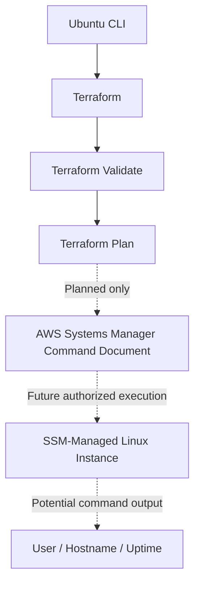
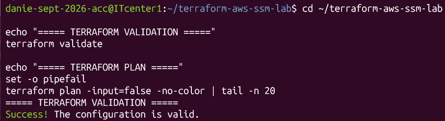

# AWS Systems Manager Terraform Lab

## Project Status

**PLAN ONLY — No AWS resources deployed by this project.**

## Project Overview

This project demonstrates how to define an AWS Systems Manager (SSM) Command document using Terraform.

The planned document contains three read-only Linux commands:

- `whoami` — Displays the current user.
- `hostname` — Displays the computer hostname.
- `uptime` — Displays how long the computer has been running.

This project is part of Module 10: Management & Governance in my AWS Cloud Engineering portfolio.

## Architecture



The diagram represents a proposed workflow, not deployed infrastructure.

## Technology Stack

- AWS Systems Manager
- Terraform
- AWS CLI
- Ubuntu Linux
- Git and GitHub

## Planned Terraform Resource

| Resource | Purpose | Status |
|---|---|---|
| `aws_ssm_document.linux_system_check` | Define Linux system information commands | Planned only |

## Document Configuration

- AWS Region: `us-east-1`
- Document name: `terraform-linux-system-check`
- Document type: `Command`
- Document format: `JSON`
- Schema version: `2.2`
- Plugin: `aws:runShellScript`

## Linux Commands

```bash
whoami
hostname
uptime
```

These commands are included in the proposed SSM document. They have not been remotely executed by this project.

## Existing AWS Environment Discovery

Read-only AWS CLI checks identified:

- AWS account: `774305591665`
- No SSM-managed instances returned
- No customer-owned SSM documents returned
- One existing EC2 instance: `i-00b425af9a114a029`
- EC2 instance type: `t3.micro`
- EC2 instance state: `stopped`

The EC2 instance was discovered, not created or modified by this project.

## Terraform Validation

Commands:

```bash
terraform init
terraform fmt -check
terraform validate
terraform plan -input=false -no-color
```

Observed results:

- Terraform formatting passed.
- Terraform validation succeeded.
- Terraform plan succeeded.
- Plan: 1 to add, 0 to change, 0 to destroy.

No Terraform apply was executed.

## Validation Evidence

See [Validation Evidence](docs/validation-evidence.md).



## Security Considerations

- Do not commit AWS credentials or private keys.
- Do not commit Terraform state files.
- Use least-privilege IAM permissions.
- Do not execute remote commands without authorization.
- Keep the existing EC2 instance stopped during this planning exercise.
- Prefer Systems Manager over publicly exposed SSH where appropriate and properly configured.

## Cost Considerations

Some AWS Systems Manager features and related AWS services can incur charges.

This project remains in PLAN ONLY mode to avoid deploying resources.

## Future Improvements

- Verify the existing EC2 instance's IAM instance profile.
- Verify SSM Agent installation and connectivity.
- Review required Systems Manager network endpoints.
- Test the document in an authorized managed-instance environment.
- Explore Session Manager, Run Command, and Patch Manager.

## Project Outcome

Successfully created and validated a Terraform configuration that proposes one AWS Systems Manager Command document without deploying or modifying existing AWS resources.
